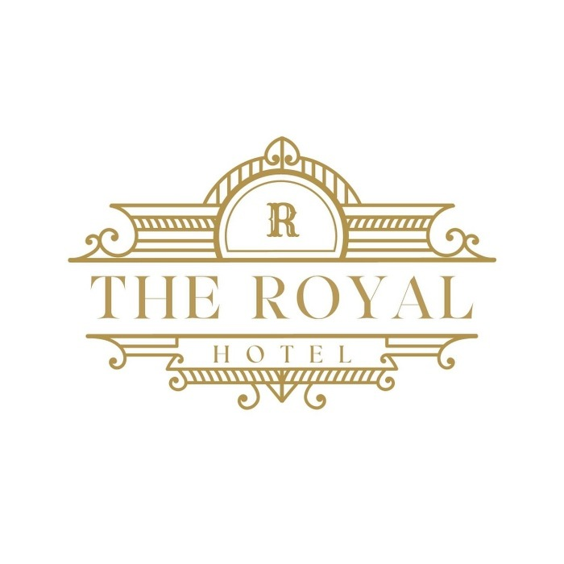

<div align="center">
  
  <h1>Hotel Management</h1>
  <p>Ứng dụng desktop quản lý vận hành khách sạn, xây dựng bằng WPF và .NET 8.</p>

  <p>
    
    
    
    
  </p>
</div>

## Giới thiệu

Hotel Management hỗ trợ các nghiệp vụ chính của khách sạn trong một ứng dụng Windows duy nhất: quản lý phòng và đặt phòng, check-in/check-out, dịch vụ, hóa đơn, nhân sự, phân quyền và báo cáo doanh thu. Dự án tổ chức theo mô hình ba lớp để tách giao diện, nghiệp vụ và truy cập dữ liệu.

## Tính năng nổi bật

- Đăng nhập nhân viên, ghi nhớ tài khoản, đổi và khôi phục mật khẩu qua email.
- Theo dõi tình trạng phòng theo thời gian; quản lý loại phòng, giá giờ/ngày, chính sách và tiện nghi.
- Đặt nhiều phòng cho khách hàng, lập phiếu thuê, check-in/check-out và theo dõi trạng thái dọn dẹp.
- Quản lý khách hàng, nhân viên, tài khoản nhân viên/khách hàng và phân quyền theo chức năng.
- Quản lý dịch vụ, loại dịch vụ, tồn kho và dịch vụ được sử dụng theo phiếu thuê.
- Lập hóa đơn phòng hoặc dịch vụ; hỗ trợ thanh toán trực tiếp và tạo liên kết thanh toán payOS.
- Thống kê doanh thu bằng biểu đồ và xuất báo cáo Excel.
- Quản lý địa điểm xung quanh chi nhánh bằng Google Places/Routes API.
- Lưu trữ ảnh phòng, dịch vụ và ảnh đại diện trên Cloudinary.

## Công nghệ sử dụng

| Thành phần | Công nghệ |
| --- | --- |
| Nền tảng | .NET 8, C# |
| Giao diện | WPF, Material Design in XAML |
| Cơ sở dữ liệu | MySQL, `MySql.Data` |
| Biểu đồ và báo cáo | LiveCharts, ClosedXML |
| Xác thực | BCrypt |
| Thanh toán | payOS, WebView2 |
| Lưu trữ ảnh | Cloudinary |
| Dữ liệu bản đồ | Google Places API, Google Routes API |

## Kiến trúc

```text
┌──────────────────────────────────────────────┐
│ GUI — WPF windows, user controls, resources  │
└──────────────────────┬───────────────────────┘
                       │ gọi nghiệp vụ
┌──────────────────────▼───────────────────────┐
│ BUS — kiểm tra và điều phối nghiệp vụ        │
└──────────────────────┬───────────────────────┘
                       │ truy cập dữ liệu
┌──────────────────────▼───────────────────────┐
│ DAL — câu lệnh MySQL, DTO, dịch vụ bên ngoài │
└──────────────────────┬───────────────────────┘
                       │
          MySQL / Cloudinary / Google APIs
```

```text
Hotel_Management/
├── GUI/                    # Ứng dụng WPF, màn hình và tài nguyên
│   ├── UserControls/       # Các màn hình chức năng chính
│   ├── View/               # Cửa sổ, hộp thoại và luồng thao tác
│   └── Res/                # Ảnh, biểu tượng và âm thanh
├── BUS/                    # Lớp nghiệp vụ
├── DAL/
│   ├── Data/               # Truy vấn MySQL và tích hợp dịch vụ
│   └── DTO/                # Mô hình truyền dữ liệu
├── Hotel_Management.sln
└── Run_With_VSCode         # Hướng dẫn chạy ngắn gọn
```

## Yêu cầu hệ thống

- Windows 10/11.
- [.NET 8 SDK](https://dotnet.microsoft.com/download/dotnet/8.0) — chỉ cài Runtime là chưa đủ để build.
- MySQL Server và một database có schema tương thích với ứng dụng.
- WebView2 Runtime để hiển thị trang thanh toán payOS.
- Kết nối Internet cho Cloudinary, email, payOS và Google APIs.
- Visual Studio 2022 hoặc VS Code với C# Dev Kit/.NET Install Tool.

> Dự án hiện chưa kèm migration, file schema SQL hoặc dữ liệu seed. Hãy nhận database tương thích từ người duy trì dự án trước khi chạy. Các bảng được ứng dụng sử dụng gồm `NhanVien`, `KhachHang`, `TaiKhoanNV`, `TaiKhoanKH`, `PhanQuyen`, `Phong`, `LoaiPhong`, `TienNghi`, `CT_TienNghi`, `PhieuThue`, `CT_PhieuThue`, `LoaiDV`, `DichVu`, `CT_SDDichVu`, `HoaDon`, `ChiNhanh` và `DiaDiemXungQuanh`.

## Cài đặt và chạy

### 1. Tải mã nguồn

```powershell
git clone https://github.com/TruongDacDien/Hotel_Management.git
cd Hotel_Management
```

### 2. Cấu hình ứng dụng

Phiên bản hiện tại đọc cấu hình từ resource của từng project. Mở các file `.resx` bằng Visual Studio Resource Editor và thiết lập các khóa sau; không chỉnh trực tiếp file `Resources.Designer.cs` vì file này được sinh tự động.

| File | Khóa | Mục đích |
| --- | --- | --- |
| `GUI/Properties/Resources.resx` | `MySqlConnection` | Chuỗi kết nối MySQL dùng tại màn hình đăng nhập |
| | `clientId`, `apiKey`, `checksumKey` | Thông tin tích hợp payOS |
| | `Email`, `Password`, `DisplayName`, `Host`, `Port` | Tài khoản SMTP gửi email khôi phục mật khẩu |
| `DAL/Properties/Resources.resx` | `MySqlConnection` | Chuỗi kết nối MySQL của lớp dữ liệu; phải trỏ cùng database với GUI |
| | `Cloudinary_Cloud_Name`, `Cloudinary_API_Key`, `Cloudinary_API_Secret` | Upload và xóa ảnh |
| | `Google_API_Key` | Google Places và Routes API |

Ví dụ định dạng chuỗi kết nối, chỉ dùng giá trị giả:

```text
Server=<host>;Database=<database>;User Id=<username>;Password=<password>;Port=3306;Charset=utf8mb4;
```

> Không commit khóa thật hoặc mật khẩu vào Git. Với môi trường production, nên chuyển toàn bộ secret sang biến môi trường, secret manager hoặc file cấu hình cục bộ đã được `.gitignore`.

### 3. Restore, build và chạy

```powershell
dotnet restore .\Hotel_Management.sln
dotnet build .\Hotel_Management.sln
dotnet run --project .\GUI\GUI.csproj
```

Ứng dụng khởi động tại màn hình đăng nhập. Tài khoản đầu tiên cần được tạo sẵn trong database và có bản ghi phân quyền tương ứng.

## Quy trình nghiệp vụ chính

1. Đăng nhập bằng tài khoản nhân viên đã được cấp quyền.
2. Khai báo loại phòng, phòng, tiện nghi, loại dịch vụ và dịch vụ.
3. Tạo hồ sơ khách hàng và phiếu đặt phòng.
4. Thực hiện check-in, ghi nhận dịch vụ phát sinh và check-out.
5. Lập hóa đơn, chọn hình thức thanh toán và cập nhật trạng thái phòng.
6. Theo dõi doanh thu hoặc xuất báo cáo Excel theo tháng/năm.

## Build bản Release

```powershell
dotnet publish .\GUI\GUI.csproj -c Release -r win-x64 --self-contained false -o .\artifacts\publish
```

Thư mục phát hành nằm tại `artifacts/publish`. Máy đích vẫn cần .NET Desktop Runtime 8 và WebView2 Runtime.

## Kiểm thử

Dự án chưa có test project tự động. Trước khi phát hành, tối thiểu nên kiểm tra thủ công các luồng:

- Đăng nhập, tài khoản bị khóa và phân quyền menu.
- Đặt phòng trùng thời gian, check-in/check-out và hủy phiếu thuê.
- Trừ tồn dịch vụ/tiện nghi và khôi phục khi thao tác thất bại.
- Thanh toán trực tiếp, thanh toán payOS và đối soát hóa đơn.
- Xuất báo cáo Excel với tháng có và không có dữ liệu.
- Mất kết nối MySQL hoặc các dịch vụ ngoài trong lúc đang thao tác.

## Lưu ý bảo mật và vận hành

- Đổi toàn bộ khóa đã từng xuất hiện trong lịch sử Git trước khi triển khai thật.
- Dùng tài khoản MySQL có quyền tối thiểu và bật TLS khi kết nối database từ xa.
- Không lưu mật khẩu người dùng dạng rõ; ứng dụng đã dùng BCrypt cho mật khẩu trong database.
- Xác minh thanh toán từ API/webhook của payOS trước khi đánh dấu hóa đơn đã thanh toán.
- Thiết lập logging tập trung; không hiển thị trực tiếp lỗi database hoặc dịch vụ ngoài cho người dùng cuối.

## Đóng góp

1. Tạo branch từ `master`.
2. Thực hiện thay đổi nhỏ, có mục đích rõ ràng.
3. Build solution và kiểm tra các luồng liên quan.
4. Tạo pull request, mô tả vấn đề, cách xử lý và ảnh giao diện nếu có.

## Giấy phép

Repository hiện chưa có file giấy phép. Mặc định, mã nguồn chưa được cấp quyền sử dụng, sửa đổi hoặc phân phối ngoài các quyền được chủ sở hữu cho phép. Hãy bổ sung `LICENSE` trước khi phát hành công khai hoặc tái sử dụng dự án.

---

Mã nguồn: [github.com/TruongDacDien/Hotel_Management](https://github.com/TruongDacDien/Hotel_Management)
